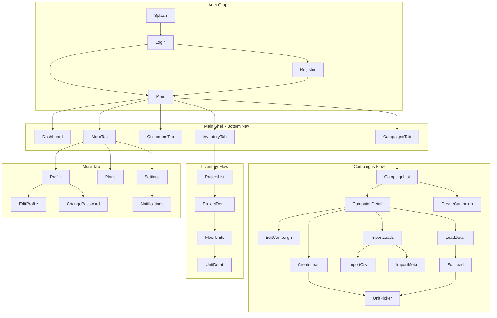

# Rumu Realtor — Kotlin Android App Plan

Complete screen-by-screen plan for building the native Android app against the Rumu Realtor API.

**Related docs:** [REALTOR_API.md](./REALTOR_API.md) (endpoints, auth, payloads)

---

## 1. Product summary

| Item | Detail |
|------|--------|
| App name | Rumu Realtor |
| Platform | Android (Kotlin) |
| Min SDK | 26 (Android 8.0) |
| Target SDK | 35 |
| Users | Realtors only (not admin) |
| Backend | Laravel REST API `/api/v1` + Sanctum tokens |
| MVP scope | Match mobile API v1 + newly added APIs (CSV import + Meta lead sync/import + inventory structure CRUD) |

### Core user journeys

1. Sign up / log in → see dashboard
2. Manage campaigns → add leads → update status → assign inventory units
3. View converted customers (won / booked / sold)
4. Browse inventory availability (read-only)
5. Import leads (CSV / Meta) into campaigns
6. Request plan upgrade, manage profile

---

## 2. Recommended tech stack

| Layer | Choice | Why |
|-------|--------|-----|
| UI | Jetpack Compose + Material 3 | Modern, less XML, good for forms/lists |
| Architecture | MVVM + Clean-ish layers | ViewModel → Repository → Retrofit |
| DI | Hilt | Standard for Android |
| Networking | Retrofit + OkHttp + Gson/Moshi | Matches API JSON envelope |
| Async | Kotlin Coroutines + Flow | `suspend` API calls, UI state as `StateFlow` |
| Navigation | Navigation Compose | Type-safe routes |
| Local storage | DataStore (token, user prefs) | EncryptedSharedPreferences for token optional |
| Images | Coil | Avatar URL loading |
| Charts | Vico or MPAndroidChart | Dashboard line/bar charts |

### Project module structure

```
app/
├── data/
│   ├── api/           # Retrofit RumuApi, DTOs, interceptors
│   ├── repository/    # CampaignRepository, LeadRepository, ...
│   └── local/         # TokenStore, UserPreferences
├── domain/
│   └── model/         # UiModel mappers (optional)
├── ui/
│   ├── auth/
│   ├── dashboard/
│   ├── campaigns/
│   ├── leads/
│   ├── customers/
│   ├── inventory/
│   ├── plans/
│   ├── profile/
│   ├── settings/
│   └── components/    # Shared: StatusChip, LoadingBox, ErrorBanner
└── di/                # Hilt modules
```

---

## 3. Navigation map



### Bottom navigation (5 tabs)

| Tab | Icon | Root screen |
|-----|------|-------------|
| Home | house | Dashboard |
| Campaigns | folder | Campaign list |
| Customers | people | Customer list |
| Inventory | building | Project list |
| More | menu | Profile hub |

---

## 4. Global UI patterns

Apply on **every** authenticated screen:

| Pattern | Behavior |
|---------|----------|
| Top app bar | Title + optional back + overflow menu |
| Pull-to-refresh | Lists and dashboard |
| Loading | Full-screen shimmer on first load; inline progress on submit |
| Errors | Snackbar for API errors; inline field errors for 422 |
| Empty state | Icon + message + primary CTA (e.g. "Create campaign") |
| Subscription banner | Red banner if `user.subscription_suspended` — block FAB/submit, allow read |
| Plan expiry banner | Amber banner from dashboard/plans `plan_expiry_warning` |
| 401 handling | Clear token → navigate to Login |
| 403 write blocked | Show snackbar: "Subscription suspended" |

### API response handling (all screens)

```kotlin
when {
    response.success && response.data != null -> // render
    response.errors != null -> // map to form fields
    else -> // show response.message
}
```

---

## 5. Screen specifications

---

### 5.1 Splash Screen

| | |
|--|--|
| **Route** | `splash` |
| **Purpose** | Brand moment + check stored token |
| **API** | None initially; optional `GET /auth/me` if token exists |

**UI components**
- Rumu logo centered
- Subtle loading indicator below logo
- Background: brand gradient (match web primary purple)

**Logic**
1. Read token from `TokenStore`
2. If no token → `Login`
3. If token → call `GET /auth/me`
   - Success → `Main`
   - 401 → clear token → `Login`

**Duration** | Max 2 seconds if token valid; no artificial delay if network slow (show loading)

---

### 5.2 Login Screen

| | |
|--|--|
| **Route** | `auth/login` |
| **API** | `POST /auth/login` |

**UI components**
- Email `OutlinedTextField` (keyboard: email)
- Password `OutlinedTextField` with visibility toggle
- "Log in" primary button (disabled until fields non-empty)
- "Create account" text button → Register
- Error text below form (from `message` or validation)

**Validation (client-side)**
- Email format
- Password non-empty

**On success**
- Save `data.token` to `TokenStore`
- Cache `data.user` in memory / DataStore
- Navigate to `Main` (clear back stack)

**Error cases**
- 422 → show field errors
- 403 → "This app is for realtors only"
- Network → "Check your connection"

---

### 5.3 Register Screen

| | |
|--|--|
| **Route** | `auth/register` |
| **API** | `POST /auth/register` |

**UI components**
- Full name
- Email
- Password
- Confirm password
- "Create account" button
- "Already have an account? Log in" link

**Validation**
- Name min 2 chars
- Password min 8 chars
- Passwords match

**On success** | Same as login (token returned on register)

---

### 5.4 Main Shell (Bottom Navigation)

| | |
|--|--|
| **Route** | `main` |
| **API** | `GET /auth/me` on resume (refresh user/plan/suspension state) |

**UI components**
- `Scaffold` with `NavigationBar`
- `NavHost` for tab destinations
- Optional: badge on More tab if plan expiring soon

**State**
- `currentUser: User`
- `isSubscriptionSuspended: Boolean`

**Behavior**
- Single activity (`MainActivity`)
- Each tab preserves its own back stack within the tab
- System back: pop inner stack, then exit app from root tab

---

### 5.5 Dashboard Screen

| | |
|--|--|
| **Route** | `main/dashboard` |
| **Tab** | Home |
| **API** | `GET /realtor/dashboard` |

**UI sections (top to bottom)**

1. **Greeting header**
   - "Hello, {firstName}"
   - Current plan chip (e.g. "Basic Plan")

2. **Plan expiry warning card** (conditional)
   - Show if `plan_expiry_warning` not null
   - Days remaining + "Renew" → Plans screen

3. **Subscription suspended card** (conditional)
   - Full-width red card → Plans screen

4. **Campaign status row** — 3 small stat cards
   - Active | Paused | Completed
   - Data: `campaign_status`

5. **Lead pipeline row** — horizontal scroll or 2×4 grid
   - New, Contacted, Qualified, Proposal, Negotiation, Won, Lost
   - Color-coded chips with counts from `lead_status`
   - Tap a status → navigate to Campaigns with filter hint (optional v1.1)

6. **Charts section**
   - Line or bar chart: `months` + `monthly_leads`
   - Secondary smaller chart: `monthly_campaigns`
   - Library: Vico Compose

7. **Recent campaigns list**
   - Max 5 items from `recent_campaigns`
   - Each row: name, status badge, lead count
   - Tap → Campaign detail
   - "View all" → Campaigns tab

**States**
- Loading: skeleton cards
- Error: retry button
- Pull-to-refresh reloads dashboard

---

### 5.6 Campaign List Screen

| | |
|--|--|
| **Route** | `main/campaigns` |
| **Tab** | Campaigns |
| **API** | `GET /realtor/campaigns` |

**UI components**
- Search bar (client-side filter on name)
- Filter chips: All | Active | Paused | Completed
- `LazyColumn` of campaign cards:
  - Name (bold)
  - Status badge (green/yellow/gray)
  - Lead count
  - Created date (relative: "3 days ago")
- FAB "+" → Create Campaign (hidden if subscription suspended)

**Empty state**
- "No campaigns yet"
- CTA: Create your first campaign

**Item tap** → Campaign Detail

**Long press** (optional) | Context menu: Edit, Delete

---

### 5.7 Create Campaign Screen

| | |
|--|--|
| **Route** | `campaigns/create` |
| **API** | `POST /realtor/campaigns` |

**Form fields**
| Field | Type | Required |
|-------|------|----------|
| Name | Text | Yes |
| Description | Multiline text | No |
| Status | Dropdown: active, paused, completed | Yes (default: active) |

**Actions**
- Save → on 201 navigate to Campaign Detail
- Cancel → back

**Errors**
- 403 plan limit → dialog: "Campaign limit reached. Upgrade plan?" → Plans

---

### 5.8 Edit Campaign Screen

| | |
|--|--|
| **Route** | `campaigns/{id}/edit` |
| **API** | `PUT /realtor/campaigns/{id}` |

Same fields as create, pre-filled from `GET /realtor/campaigns/{id}`.

**Additional**
- Delete button at bottom (destructive)
- Delete → confirm dialog → `DELETE /realtor/campaigns/{id}` → pop to list

---

### 5.9 Campaign Detail Screen

| | |
|--|--|
| **Route** | `campaigns/{id}` |
| **API** | `GET /realtor/campaigns/{id}` (includes leads summary) |

**UI sections**

1. **Header card**
   - Campaign name
   - Status badge
   - Description (if any)
   - Edit icon in app bar

2. **Stats row** (compute from leads in response)
   - Total leads | Won | In progress | Lost

3. **Leads section**
   - Section title "Leads" + count
   - Search (client-side on name/phone)
   - Status filter chips
   - `LazyColumn` lead rows:
     - Name, phone, status chip
     - Tap → Lead Detail
   - Pagination: `GET /realtor/campaigns/{id}/leads?page=N` if not all loaded in show response

4. **FAB** "+" → Create Lead

5. **Import action** (new)
   - Button in app bar overflow or a secondary CTA card: “Import leads”
   - Navigates to Import Leads screen
   - APIs:
     - CSV: `POST /realtor/campaigns/{campaignId}/import/csv` (multipart `csv_file`)
     - Sample: `GET /realtor/campaigns/{campaignId}/import/sample`
     - Meta CSV: `POST /realtor/campaigns/{campaignId}/import/meta/csv` (multipart `csv_file`)
     - Meta sample: `GET /realtor/campaigns/{campaignId}/import/meta/sample`
     - Meta forms: `GET /realtor/campaigns/{campaignId}/meta/forms`
     - Meta sync: `POST /realtor/campaigns/{campaignId}/meta/sync` body `{ "form_id": "..." }`

**Note:** Prefer paginated leads endpoint for large campaigns even if show returns embedded leads.

---

### 5.10 Lead List (embedded in Campaign Detail)

See 5.9. Can be extracted to composable `LeadListSection`.

**API** | `GET /realtor/campaigns/{campaignId}/leads?page=1`

**Pagination** | Infinite scroll when `meta.current_page < meta.last_page`

---

### 5.11 Create Lead Screen

| | |
|--|--|
| **Route** | `campaigns/{campaignId}/leads/create` |
| **API** | `POST /realtor/campaigns/{campaignId}/leads` |

**Form — Section 1: Basic information**
| Field | API key | Required |
|-------|---------|----------|
| Lead name | `name` | Yes |
| Email | `email` | No |
| Phone | `phone` | No |
| Company | `company` | No |
| Status | `status` | Yes (default: `new`) |
| Initial note | `note` | No |

**Form — Section 2: Buyer / client details** (`custom_fields`)

Use `ExposedDropdownMenu` or bottom sheet pickers:

| Label | API key | Options |
|-------|---------|---------|
| Client type | `client_type` | buyer, seller, investor, tenant |
| Budget range | `budget_range` | below_50l, 50l_75l, 75l_1cr, 1cr_1.5cr, 1.5cr_2cr, 2cr_3cr, 3cr_5cr, above_5cr |
| Purpose | `purpose` | self_use, investment, rental |
| Property type | `property_type` | apartment, villa, plot, commercial, office, shop |
| Configuration | `configuration` | studio, 1_bhk, 2_bhk, 3_bhk, 4_bhk, 4+_bhk |
| Lead priority | `lead_priority` | hot, warm, cold |
| Buying timeline | `buying_timeline` | immediate, 1_3_months, 3_6_months, 6_12_months, just_browsing |
| Funding type | `funding_type` | self, loan, bank_approved |
| Preferred location | `preferred_location` | text |
| City | `city` | text |
| Construction status | `construction_status` | ready_to_move, under_construction, both |
| Site visit required | `site_visit_required` | yes, no |
| Preferred visit date | `preferred_visit_date` | date picker |
| Landmarks | `landmarks` | text |
| Lead source | `lead_source` | facebook, google, portal, walk_in, referral, other |

**Form — Section 3: Inventory unit**
- Row: "Assigned unit" → tap opens **Unit Picker**
- Shows selected unit `full_path` or "None"
- Maps to `inventory_unit_id`

**UX**
- Collapse "Advanced details" accordion by default (only Basic + Unit visible)
- Save button fixed at bottom

**On success** → Lead Detail

**Errors**
- 403 lead limit → upgrade dialog
- 422 unit already assigned → show message

---

### 5.12 Edit Lead Screen

| | |
|--|--|
| **Route** | `leads/{id}/edit` |
| **API** | `GET /realtor/leads/{id}` then `PUT /realtor/leads/{id}` |

Same form as Create Lead, pre-filled.

**Difference from create**
- Initial note field hidden (use notes on detail screen)
- Status editable here and on detail via quick actions

---

### 5.13 Lead Detail Screen

| | |
|--|--|
| **Route** | `leads/{id}` |
| **API** | `GET /realtor/leads/{id}` |

**UI sections**

1. **Header**
   - Lead name (large)
   - Status chip (tappable → status bottom sheet)
   - Campaign name (link to campaign detail)

2. **Quick actions row**
   - Call (`phone` → `ACTION_DIAL`)
   - Email (`email` → `ACTION_SENDTO`)
   - WhatsApp (if phone → `wa.me` intent) optional

3. **Contact card**
   - Phone, email, company

4. **Inventory unit card** (if assigned)
   - Unit full path
   - Unit status badge (available/hold/booked/sold)
   - Tap → Unit Detail (read-only)

5. **Custom fields card**
   - Key-value list from `custom_fields`
   - Human-readable labels (map `budget_range` → "₹1Cr – ₹1.5Cr")

6. **Status pipeline** (horizontal stepper)
   - Highlight current status in pipeline: new → contacted → qualified → proposal → negotiation → won/lost

7. **Notes timeline**
   - Chronological list from `notes`
   - Each: note text, author name, timestamp

8. **Add note**
   - Text field + "Add note" button
   - API: `POST /realtor/leads/{id}/notes`

9. **App bar actions**
   - Edit → Edit Lead

**Status change bottom sheet**
- List all statuses
- On select → `PATCH /realtor/leads/{id}/status` with `{ "status": "..." }`
- Refresh lead (inventory unit status may sync)

---

### 5.14 Unit Picker Screen (Bottom Sheet or Full Screen)

| | |
|--|--|
| **Route** | `unit-picker?projectId=` |
| **API** | `GET /realtor/inventory/units/search?q=&project_id=` |

**UI**
- Search field (debounced 300ms)
- Optional project filter dropdown (load projects from `GET /realtor/inventory/projects`)
- List rows: unit path, layout, status, price
- "Clear selection" row at top
- Tap row → return `inventory_unit_id` to previous screen

**Used by** | Create Lead, Edit Lead

---

### 5.15 Customer List Screen

| | |
|--|--|
| **Route** | `main/customers` |
| **Tab** | Customers |
| **API** | `GET /realtor/customers?search=&status=&page=` |

**UI sections**

1. **Stats row** — 4 cards from `data.stats`
   - Total | Won | Booked | Sold

2. **Search bar** — debounced, passes `search` query param

3. **Filter chips** — All | Won | Booked | Sold (`status` param)

4. **Customer list**
   - Name (bold)
   - Phone
   - Campaign name
   - Lead status chip + unit status chip
   - Unit path (subtitle)
   - Tap → Lead Detail (customers are leads)

**Empty state**
- "No customers yet"
- Subtitle: "Leads marked Won or linked to booked/sold units appear here"

**Pagination** | Infinite scroll via `page` param

---

### 5.16 Inventory — Project List Screen

| | |
|--|--|
| **Route** | `main/inventory` |
| **Tab** | Inventory |
| **API** | `GET /realtor/inventory/projects` |

**UI**
- List of project cards:
  - Project name, city/location
  - Availability summary bar: available / hold / booked / sold counts
  - Mini colored segments (green/yellow/blue/red)
- Tap → Project Detail

**Empty state**
- "No inventory projects"
- Subtitle: "Create a project to start tracking availability"

**New in API**
- You can now create/update/delete inventory structure from the app:
  - `POST /realtor/inventory/projects`
  - `PUT/DELETE /realtor/inventory/projects/{id}`
  - Towers/wings/floors/units CRUD under `/realtor/inventory/*`

---

### 5.17 Inventory — Project Detail Screen

| | |
|--|--|
| **Route** | `inventory/projects/{id}` |
| **API** | `GET /realtor/inventory/projects/{id}` |

**UI sections**

1. **Project header**
   - Name, location, city, description

2. **Availability summary** — same 4-stat cards as web

3. **Floor selector**
   - Dropdown or list grouped by tower:
     - Tower name as header
     - Floor rows: "Floor 10 (61 units)" from `towers[].floors[]`
   - Tap floor → Floor Units screen

**Optional (now supported by API)**
- Add edit controls (P2) for inventory structure:
  - Add tower / wing / floor / units (incl. bulk units)
  - Update unit status (`PATCH /realtor/inventory/units/{id}/status`)

---

### 5.18 Inventory — Floor Units Screen

| | |
|--|--|
| **Route** | `inventory/floors/{floorId}/units` |
| **API** | `GET /realtor/inventory/floors/{floorId}/units?status=&layout=` |

**UI**
- Filter chips: status (all, available, hold, booked, sold)
- Layout filter: studio, 1 BHK, etc.
- Table-style list:
  - Unit number | Layout | Status badge | Price
- Tap → Unit Detail

**Pagination** | If `meta` present, infinite scroll

---

### 5.19 Inventory — Unit Detail Screen (Read-only)

| | |
|--|--|
| **Route** | `inventory/units/{id}` (local nav; data from list or lead) |
| **API** | No dedicated endpoint — use unit from floor list or `lead.inventory_unit` |

**UI**
- Unit number (title)
- Full path (project › tower › floor › unit)
- Layout, carpet area, built-up area, facing
- Base price (formatted ₹)
- Status badge
- Linked lead (if any) → Lead Detail

**v1** | Read-only; status changes happen via lead status sync

---

### 5.20 Plans Screen

| | |
|--|--|
| **Route** | `more/plans` |
| **API** | `GET /realtor/plans`, `POST /realtor/plans/upgrade` |

**UI sections**

1. **Current plan card**
   - Plan name, campaigns used / limit
   - Expiry progress bar if Pro + `expiry_info`

2. **Pending upgrade banner** (if `pending_upgrade`)
   - "Upgrade to {plan} pending admin approval"

3. **Plan cards list** (`plans`)
   - Plan name, price (/month or Free)
   - Features: campaigns limit, leads per campaign
   - CTA button per card:
     - Current plan → disabled "Current plan"
     - Upgrade available → "Request upgrade"
     - Not available → disabled

4. **Upgrade flow**
   - Tap "Request upgrade" → confirm dialog
   - `POST /realtor/plans/upgrade` `{ "plan_id": N }`
   - Success snackbar; refresh screen

---

### 5.21 More / Profile Hub Screen

| | |
|--|--|
| **Route** | `main/more` |
| **Tab** | More |
| **API** | `GET /realtor/profile` |

**UI**
- Avatar circle (initials or `avatar_url` via Coil)
- Name, email, plan badge
- Stats row: campaigns | leads | won (from `stats`)

**Menu list**
| Row | Destination |
|-----|-------------|
| My Profile | Profile detail |
| Plans & Billing | Plans screen |
| Settings | Settings screen |
| Log out | Confirm → `POST /auth/logout` → Login |

---

### 5.22 Profile Detail Screen

| | |
|--|--|
| **Route** | `more/profile` |
| **API** | `GET /realtor/profile` |

**UI**
- Read-only display of name, email, phone, company, bio
- "Edit profile" button → Edit Profile
- "Change password" button → Change Password

---

### 5.23 Edit Profile Screen

| | |
|--|--|
| **Route** | `more/profile/edit` |
| **API** | `PUT /realtor/profile` |

**Fields**
- Name, email, phone, company, bio (multiline)

**Note** | Avatar upload deferred to v1.1 (API not in v1)

---

### 5.24 Change Password Screen

| | |
|--|--|
| **Route** | `more/profile/password` |
| **API** | `PUT /realtor/profile/password` |

**Fields**
- Current password
- New password
- Confirm new password

**Validation** | Min 8 chars, confirmation match

---

### 5.25 Settings Screen

| | |
|--|--|
| **Route** | `more/settings` |
| **API** | `PUT /realtor/settings/notifications` |

**UI**
- **Notifications section**
  - Toggle: Email notifications → `email_notifications`
  - Toggle: Marketing emails → `marketing_emails`
  - Auto-save on toggle change

**Deferred to v1.1** (web has, API not yet)
- Appearance / theme
- Language
- Timezone
- Delete account

---

### 5.26 Logout Confirmation Dialog

| | |
|--|--|
| **Trigger** | More hub → Log out |
| **API** | `POST /auth/logout` |

**Dialog**
- "Log out of Rumu?"
- Buttons: Cancel | Log out

**On confirm**
- Call logout API
- Clear `TokenStore`
- Navigate to Login (clear entire back stack)

**Optional** | "Log out all devices" → `POST /auth/logout-all`

---

## 6. Data layer detail

### 6.1 DTOs (match API resources)

```kotlin
// Core envelope
data class ApiResponse<T>(
    val success: Boolean,
    val data: T?,
    val message: String?,
    val errors: Map<String, List<String>>? = null,
    val meta: PaginationMeta? = null
)

data class PaginationMeta(
    val current_page: Int,
    val last_page: Int,
    val per_page: Int,
    val total: Int
)

data class AuthData(
    val token: String,
    val token_type: String,
    val user: UserDto
)

data class UserDto(
    val id: Int,
    val name: String,
    val email: String,
    val phone: String?,
    val company: String?,
    val bio: String?,
    val role: String,
    val avatar_url: String?,
    val subscription_suspended: Boolean,
    val plan: PlanDto?
)

data class LeadDto(
    val id: Int,
    val campaign_id: Int,
    val name: String,
    val email: String?,
    val phone: String?,
    val company: String?,
    val status: String,
    val custom_fields: Map<String, String>?,
    val inventory_unit_id: Int?,
    val inventory_unit: InventoryUnitDto?,
    val notes: List<LeadNoteDto>?
)
```

### 6.2 Repositories

| Repository | Methods |
|------------|---------|
| `AuthRepository` | login, register, me, logout |
| `DashboardRepository` | getDashboard |
| `CampaignRepository` | list, get, create, update, delete |
| `LeadRepository` | listByCampaign, get, create, update, updateStatus, addNote |
| `CustomerRepository` | list |
| `InventoryRepository` | listProjects, getProject, floorUnits, searchUnits, createProject, updateProject, deleteProject, createTower, updateTower, deleteTower, createWing, updateWing, deleteWing, createFloor, updateFloor, deleteFloor, createUnit, bulkCreateUnits, updateUnit, updateUnitStatus, deleteUnit |
| `LeadImportRepository` | importCsv, downloadCsvSample, importMetaCsv, downloadMetaSample, listMetaForms, syncMetaLeads |
| `PlanRepository` | getPlans, requestUpgrade |
| `ProfileRepository` | getProfile, updateProfile, updatePassword, updateNotifications |

### 6.3 Token storage

```kotlin
interface TokenStore {
    suspend fun getToken(): String?
    suspend fun saveToken(token: String)
    suspend fun clear()
}
```

Use `EncryptedSharedPreferences` or DataStore in production.

---

## 7. ViewModels (one per screen)

| Screen | ViewModel | Key StateFlow |
|--------|-----------|---------------|
| Login | `LoginViewModel` | `uiState: LoginUiState` |
| Dashboard | `DashboardViewModel` | `dashboard: DashboardUi?`, `isLoading`, `error` |
| CampaignList | `CampaignListViewModel` | `campaigns`, `filter` |
| CampaignDetail | `CampaignDetailViewModel` | `campaign`, `leads` |
| LeadDetail | `LeadDetailViewModel` | `lead`, `noteInput` |
| CustomerList | `CustomerListViewModel` | `stats`, `customers`, `searchQuery` |
| ProjectList | `InventoryProjectsViewModel` | `projects` |
| Plans | `PlansViewModel` | `plans`, `currentPlan`, `pendingUpgrade` |
| Profile | `ProfileViewModel` | `user`, `stats` |

**UiState pattern**

```kotlin
data class LeadDetailUiState(
    val isLoading: Boolean = true,
    val lead: LeadUi? = null,
    val error: String? = null,
    val isAddingNote: Boolean = false
)
```

---

## 8. Theming & branding

| Token | Value (match web) |
|-------|-------------------|
| Primary | Purple `#6B21A8` area (use web `primary` from Tailwind config) |
| Secondary | Light accent |
| Status: new | Blue |
| Status: won | Green |
| Status: lost | Red |
| Unit: available | Green |
| Unit: booked | Blue |
| Unit: sold | Red |

**Typography** | Material 3 default (Roboto) or custom brand font

**Dark mode** | v1.1 — web supports theme; API does not expose yet for settings

---

## 9. Implementation phases

### Phase 1 — Foundation (Week 1)
- [ ] Android project setup (Compose, Hilt, Retrofit)
- [ ] `TokenStore`, `AuthInterceptor`, `RumuApi`
- [ ] Splash, Login, Register
- [ ] Main shell + empty tab placeholders
- [ ] Global error / 401 handling

### Phase 2 — Core CRM (Week 2)
- [ ] Dashboard with charts
- [ ] Campaign list / create / edit / delete
- [ ] Campaign detail + lead list
- [ ] Lead create / edit / detail
- [ ] Notes + status update

### Phase 3 — Inventory & Customers (Week 3)
- [ ] Customer list with search/filters
- [ ] Unit picker bottom sheet
- [ ] Inventory project list / detail
- [ ] Floor units + unit detail

### Phase 4 — Account (Week 4)
- [ ] Plans + upgrade request
- [ ] Profile hub / edit / password
- [ ] Notification settings
- [ ] Subscription suspended UX polish

### Phase 5 — Polish & release (Week 5)
- [ ] Pull-to-refresh everywhere
- [ ] Empty / error states
- [ ] Unit tests (ViewModels)
- [ ] UI tests (login flow, create lead)
- [ ] Play Store internal testing build

---

## 10. Testing plan

| Type | Coverage |
|------|----------|
| Unit | ViewModels with fake repositories |
| Integration | Retrofit against local Laravel (`10.0.2.2`) |
| UI (Compose) | Login → Dashboard; Create campaign → Add lead |
| Manual | Subscription suspended, plan limit errors, pagination |

---

## 11. Out of scope for v1 (document in app)

Show "Available on web" links or hide features:

| Feature | Web route |
|---------|-----------|
| Google / Facebook login | `/login` |
| Avatar upload | Profile |
| Account deletion | Settings |

---

## 12. Screen checklist (22 screens)

| # | Screen | Priority | API ready |
|---|--------|----------|-----------|
| 1 | Splash | P0 | Yes |
| 2 | Login | P0 | Yes |
| 3 | Register | P0 | Yes |
| 4 | Dashboard | P0 | Yes |
| 5 | Campaign list | P0 | Yes |
| 6 | Create campaign | P0 | Yes |
| 7 | Edit campaign | P1 | Yes |
| 8 | Campaign detail | P0 | Yes |
| 9 | Create lead | P0 | Yes |
| 10 | Edit lead | P1 | Yes |
| 11 | Lead detail | P0 | Yes |
| 12 | Unit picker | P1 | Yes |
| 13 | Customer list | P1 | Yes |
| 14 | Project list | P1 | Yes |
| 15 | Project detail | P1 | Yes |
| 16 | Floor units | P1 | Yes |
| 17 | Unit detail | P2 | Partial (from list/lead) |
| 18 | Plans | P1 | Yes |
| 19 | More / profile hub | P1 | Yes |
| 20 | Edit profile | P2 | Yes |
| 21 | Change password | P2 | Yes |
| 22 | Settings (notifications) | P2 | Yes |

---

## 13. Next steps

1. Create Android Studio project `rumu-realtor` with package `com.rumu.realtor`
2. Implement Phase 1 against `http://192.168.1.2:8000/api/v1/`
3. Use this document as the screen spec for each PR
4. Keep [REALTOR_API.md](./REALTOR_API.md) updated when backend adds v1.1 endpoints
