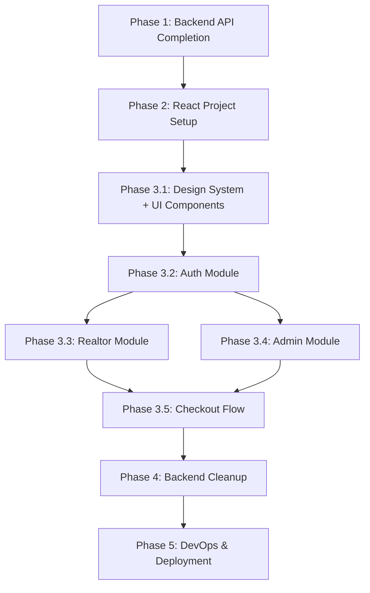

# 🚀 Rumu V2 — Frontend & Backend Separation Plan

> **Goal:** Backend ko pure REST API (Laravel) banake rakhna hai, aur Frontend ko React (Vite) mein build karna hai.

---

## 📁 Current State Analysis

### Current Architecture
```
rumu-v2/
├── Backend/          ← Laravel 12 (Monolith — Blade views + API routes dono hai)
│   ├── routes/web.php       ← 257 lines — Blade-based pages serve karta hai
│   ├── routes/api.php       ← 123 lines — API controllers already exist ✅
│   ├── resources/views/     ← 10+ Blade view folders (admin, realtor, auth, etc.)
│   ├── app/Http/Controllers/Api/  ← API controllers already built ✅
│   └── app/Http/Controllers/      ← Web controllers (Blade render karte hain)
└── frontend/         ← Empty folder (React yahan aayega)
```

### What Already Exists (API) ✅
| Module | API Controller | Status |
|--------|---------------|--------|
| Auth (Register, Login, Me, Logout) | `Api/AuthController` | ✅ Done |
| Admin Dashboard | `Api/Admin/DashboardController` | ✅ Done |
| Admin Leads | `Api/Admin/LeadsController` | ✅ Done |
| Admin Plans CRUD | `Api/Admin/PlansController` | ✅ Done |
| Admin Users | `Api/Admin/UsersController` | ✅ Done |
| Admin Upgrade Requests | `Api/Admin/UpgradeRequestsController` | ✅ Done |
| Admin Notifications | `Api/Admin/NotificationsController` | ✅ Done |
| Admin Settings | `Api/Admin/SettingsController` | ✅ Done |
| Realtor Dashboard | `Api/Realtor/DashboardController` | ✅ Done |
| Realtor Campaigns CRUD | `Api/Realtor/CampaignController` | ✅ Done |
| Realtor Leads CRUD + Import | `Api/Realtor/LeadController` + `LeadImportController` | ✅ Done |
| Realtor Customers | `Api/Realtor/CustomerController` | ✅ Done |
| Realtor Inventory (Full CRUD) | `Api/Realtor/InventoryController` | ✅ Done |
| Realtor Plans + Upgrade | `Api/Realtor/PlanController` | ✅ Done |
| Realtor Profile | `Api/Realtor/ProfileController` | ✅ Done |

### What's MISSING from API (Needs to be Built) ❌
| Module | Blade Route Exists | API Route Exists | Action |
|--------|-------------------|-----------------|--------|
| **Checkout (Razorpay)** | ✅ `web.php` | ❌ | Build API endpoints |
| **Razorpay Webhooks** | ✅ `web.php` | ❌ | Keep as web route (server-to-server) |
| **Social Login (Google/Facebook)** | ✅ `web.php` | ❌ | Build OAuth flow for SPA |
| **Social Account Linking** | ✅ `web.php` | ❌ | Build API endpoints |
| **Meta Integration** | ✅ `web.php` | ❌ | Build API endpoints |
| **Meta Webhooks** | ✅ `web.php` | ❌ | Keep as web route (server-to-server) |
| **Admin Billing (Subscriptions, Payments, Invoices)** | ✅ `web.php` | ❌ | Build API endpoints |
| **Admin Coupons & Referrals** | ✅ `web.php` | ❌ | Build API endpoints |
| **Admin Billing Notifications** | ✅ `web.php` | ❌ | Build API endpoints |
| **Admin Billing Settings** | ✅ `web.php` | ❌ | Build API endpoints |
| **Admin Realtor Management** | ✅ `web.php` | ❌ | Build API endpoints |
| **Admin Analytics (Revenue, Payments, Reports)** | ✅ `web.php` | ❌ | Build API endpoints |
| **Realtor Settings (Notifications, Privacy, Appearance)** | ✅ `web.php` | ❌ | Build API endpoints |
| **Realtor Billing (Invoices, Notifications)** | ✅ `web.php` | ❌ | Build API endpoints |
| **Realtor Account Deletion** | ✅ `web.php` | ❌ | Build API endpoint |

### Existing Blade Views (To Be Replaced by React Pages)
```
resources/views/
├── admin/
│   ├── dashboard.blade.php
│   ├── analytics/ (dashboard, revenue, payments, reports)
│   ├── billing/ (subscriptions, payments, invoices, coupons, notifications)
│   ├── leads/
│   ├── notifications/
│   ├── plans/ (index, create, edit)
│   ├── realtors/ (index, show, create, edit, billing)
│   ├── settings/
│   ├── upgrade_requests/
│   └── users/
├── auth/
│   ├── login.blade.php
│   └── register.blade.php
├── billing/
│   ├── checkout.blade.php
│   ├── success.blade.php
│   ├── failure.blade.php
│   └── invoice.blade.php
├── campaigns/
│   ├── index, create, edit, show.blade.php
│   └── meta-integration.blade.php
├── inventory/
│   └── projects/ (index, create, show, edit)
├── leads/
│   ├── create, edit, show.blade.php
│   └── import-meta.blade.php
├── realtor/
│   ├── dashboard, plans, profile, settings.blade.php
│   ├── billing/ (index, invoice)
│   └── customers/
├── layouts/
│   ├── app.blade.php (Realtor layout)
│   └── admin.blade.php (Admin layout)
└── legal/ (privacy-policy, terms-of-service)
```

### Models (28 Total)
`User`, `Lead`, `LeadNote`, `Campaign`, `Plan`, `Subscription`, `Payment`, `Invoice`, `InvoiceItem`, `Coupon`, `CouponUsage`, `InventoryProject`, `InventoryTower`, `InventoryWing`, `InventoryFloor`, `InventoryUnit`, `InventoryUnitStatusLog`, `Notification`, `BillingSetting`, `BillingSettingAudit`, `BillingNotification`, `BillingNotificationTemplate`, `PlanUpgradeRequest`, `Setting`, `MetaPage`, `MetaSyncLog`, `MetaCapiEvent`, `MetaCapiSetting`

---

## 🏗️ Phase-wise Execution Plan

---

### Phase 1: Backend — Complete API Layer
> **Goal:** Backend ko pure JSON API banao, taaki React consume kar sake

#### 1.1 Missing API Endpoints Build karo

**Priority 1 — Auth & Checkout (Critical Path)**
```
POST   /api/v1/auth/social/google          → Google OAuth token exchange
POST   /api/v1/auth/social/facebook        → Facebook OAuth token exchange
POST   /api/v1/auth/social/google/link     → Link Google account
POST   /api/v1/auth/social/google/unlink   → Unlink Google account  
POST   /api/v1/auth/social/facebook/link   → Link Facebook account
POST   /api/v1/auth/social/facebook/unlink → Unlink Facebook account

POST   /api/v1/checkout/create-order       → Razorpay order create
POST   /api/v1/checkout/verify             → Payment verify
POST   /api/v1/checkout/apply-coupon       → Apply coupon
POST   /api/v1/checkout/remove-coupon      → Remove coupon
```

**Priority 2 — Admin Billing & Analytics**
```
GET    /api/v1/admin/billing/subscriptions
PUT    /api/v1/admin/billing/subscriptions/{id}
GET    /api/v1/admin/billing/payments
GET    /api/v1/admin/billing/payments/{id}
GET    /api/v1/admin/billing/invoices
GET    /api/v1/admin/billing/invoices/{id}
GET    /api/v1/admin/billing/invoices/{id}/download

CRUD   /api/v1/admin/billing/coupons
GET    /api/v1/admin/billing/referrals

CRUD   /api/v1/admin/billing/notification-templates
GET    /api/v1/admin/billing/notifications
POST   /api/v1/admin/billing/notifications/{id}/resend

GET    /api/v1/admin/billing/settings
POST   /api/v1/admin/billing/settings

GET    /api/v1/admin/analytics/dashboard
GET    /api/v1/admin/analytics/revenue
GET    /api/v1/admin/analytics/payments
GET    /api/v1/admin/analytics/reports
POST   /api/v1/admin/analytics/reports/export

CRUD   /api/v1/admin/realtors
GET    /api/v1/admin/realtors/{id}/billing
POST   /api/v1/admin/realtors/{id}/assign-plan
POST   /api/v1/admin/realtors/{id}/suspend
POST   /api/v1/admin/realtors/{id}/resume
```

**Priority 3 — Realtor Extended Features**
```
GET    /api/v1/realtor/settings
PUT    /api/v1/realtor/settings/notifications
PUT    /api/v1/realtor/settings/privacy
PUT    /api/v1/realtor/settings/appearance
DELETE /api/v1/realtor/settings/account

GET    /api/v1/realtor/billing
GET    /api/v1/realtor/billing/invoices/{id}
GET    /api/v1/realtor/billing/invoices/{id}/download
GET    /api/v1/realtor/billing/notifications
POST   /api/v1/realtor/billing/notifications/{id}/read

GET    /api/v1/realtor/campaigns/{id}/meta-integration
POST   /api/v1/realtor/campaigns/{id}/meta-integration/disconnect-form
POST   /api/v1/realtor/campaigns/{id}/meta-integration/capi
POST   /api/v1/realtor/leads/{id}/meta-capi/resend
```

#### 1.2 CORS Configuration
```php
// config/cors.php
'paths' => ['api/*', 'sanctum/csrf-cookie'],
'allowed_origins' => ['http://localhost:5173', 'https://app.rumu.in'],
'supports_credentials' => true,
```

#### 1.3 Sanctum SPA Auth Setup
```php
// .env additions
SANCTUM_STATEFUL_DOMAINS=localhost:5173,app.rumu.in
SESSION_DOMAIN=.rumu.in  // Production
```

#### 1.4 API Resource Classes (Missing ones)
```
App\Http\Resources\
├── SubscriptionResource.php        (new)
├── PaymentResource.php             (new)
├── InvoiceResource.php             (new)
├── CouponResource.php              (new)
├── BillingNotificationResource.php (new)
├── NotificationResource.php        (new)
├── SettingsResource.php            (new)
├── AnalyticsResource.php           (new)
└── RealtorDetailResource.php       (new)
```

---

### Phase 2: React Frontend Setup
> **Goal:** `frontend/` folder mein Vite + React app initialize karo

#### 2.1 Project Initialization
```bash
cd frontend
npx -y create-vite@latest ./ --template react
npm install
```

#### 2.2 Dependencies Install
```bash
# Core
npm install react-router-dom axios

# State Management
npm install @tanstack/react-query zustand

# UI Library
npm install @headlessui/react @heroicons/react

# Forms & Validation
npm install react-hook-form zod @hookform/resolvers

# Tables & Data
npm install @tanstack/react-table

# Notifications & Toast
npm install react-hot-toast

# Charts (Admin Analytics)
npm install recharts

# Date handling
npm install date-fns

# Razorpay
npm install razorpay  # (or load via CDN script)
```

#### 2.3 Project Structure
```
frontend/
├── public/
│   └── favicon.ico
├── src/
│   ├── main.jsx
│   ├── App.jsx
│   ├── index.css
│   │
│   ├── api/                      ← Axios config + API service functions
│   │   ├── axios.js              ← Base instance (baseURL, interceptors)
│   │   ├── auth.js               ← login, register, me, logout, social
│   │   ├── admin/
│   │   │   ├── dashboard.js
│   │   │   ├── leads.js
│   │   │   ├── plans.js
│   │   │   ├── users.js
│   │   │   ├── realtors.js
│   │   │   ├── billing.js
│   │   │   ├── analytics.js
│   │   │   ├── notifications.js
│   │   │   ├── settings.js
│   │   │   └── upgradeRequests.js
│   │   └── realtor/
│   │       ├── dashboard.js
│   │       ├── campaigns.js
│   │       ├── leads.js
│   │       ├── customers.js
│   │       ├── inventory.js
│   │       ├── plans.js
│   │       ├── profile.js
│   │       ├── settings.js
│   │       ├── billing.js
│   │       └── metaIntegration.js
│   │
│   ├── stores/                   ← Zustand state stores
│   │   ├── authStore.js          ← user, token, isAuthenticated
│   │   ├── themeStore.js         ← dark/light mode, accent color
│   │   └── notificationStore.js  ← unread count, real-time
│   │
│   ├── hooks/                    ← Custom React hooks
│   │   ├── useAuth.js
│   │   ├── usePermissions.js
│   │   └── useDebounce.js
│   │
│   ├── components/               ← Reusable UI components
│   │   ├── ui/                   ← Atomic components
│   │   │   ├── Button.jsx
│   │   │   ├── Input.jsx
│   │   │   ├── Select.jsx
│   │   │   ├── Modal.jsx
│   │   │   ├── Badge.jsx
│   │   │   ├── Card.jsx
│   │   │   ├── Table.jsx
│   │   │   ├── Pagination.jsx
│   │   │   ├── Spinner.jsx
│   │   │   ├── EmptyState.jsx
│   │   │   └── ConfirmDialog.jsx
│   │   ├── layout/
│   │   │   ├── AdminLayout.jsx   ← Admin sidebar + topbar
│   │   │   ├── RealtorLayout.jsx ← Realtor sidebar + topbar
│   │   │   ├── Sidebar.jsx
│   │   │   ├── Topbar.jsx
│   │   │   └── MobileNav.jsx
│   │   └── shared/
│   │       ├── StatsCard.jsx
│   │       ├── DataTable.jsx
│   │       ├── SearchFilter.jsx
│   │       ├── FileUploader.jsx
│   │       └── StatusBadge.jsx
│   │
│   ├── pages/                    ← Route-level page components
│   │   ├── auth/
│   │   │   ├── LoginPage.jsx
│   │   │   ├── RegisterPage.jsx
│   │   │   └── SocialCallback.jsx
│   │   ├── checkout/
│   │   │   ├── CheckoutPage.jsx
│   │   │   ├── SuccessPage.jsx
│   │   │   └── FailurePage.jsx
│   │   ├── admin/
│   │   │   ├── DashboardPage.jsx
│   │   │   ├── LeadsPage.jsx
│   │   │   ├── UsersPage.jsx
│   │   │   ├── PlansPage.jsx
│   │   │   ├── PlanFormPage.jsx
│   │   │   ├── UpgradeRequestsPage.jsx
│   │   │   ├── NotificationsPage.jsx
│   │   │   ├── SettingsPage.jsx
│   │   │   ├── realtors/
│   │   │   │   ├── RealtorListPage.jsx
│   │   │   │   ├── RealtorDetailPage.jsx
│   │   │   │   └── RealtorBillingPage.jsx
│   │   │   ├── billing/
│   │   │   │   ├── SubscriptionsPage.jsx
│   │   │   │   ├── PaymentsPage.jsx
│   │   │   │   ├── InvoicesPage.jsx
│   │   │   │   ├── CouponsPage.jsx
│   │   │   │   ├── ReferralsPage.jsx
│   │   │   │   ├── BillingNotificationsPage.jsx
│   │   │   │   └── BillingSettingsPage.jsx
│   │   │   └── analytics/
│   │   │       ├── AnalyticsDashboardPage.jsx
│   │   │       ├── RevenuePage.jsx
│   │   │       ├── AnalyticsPaymentsPage.jsx
│   │   │       └── ReportsPage.jsx
│   │   ├── realtor/
│   │   │   ├── DashboardPage.jsx
│   │   │   ├── campaigns/
│   │   │   │   ├── CampaignListPage.jsx
│   │   │   │   ├── CampaignCreatePage.jsx
│   │   │   │   ├── CampaignEditPage.jsx
│   │   │   │   ├── CampaignDetailPage.jsx
│   │   │   │   └── MetaIntegrationPage.jsx
│   │   │   ├── leads/
│   │   │   │   ├── LeadCreatePage.jsx
│   │   │   │   ├── LeadEditPage.jsx
│   │   │   │   ├── LeadDetailPage.jsx
│   │   │   │   └── MetaImportPage.jsx
│   │   │   ├── customers/
│   │   │   │   └── CustomerListPage.jsx
│   │   │   ├── inventory/
│   │   │   │   ├── ProjectListPage.jsx
│   │   │   │   ├── ProjectCreatePage.jsx
│   │   │   │   ├── ProjectDetailPage.jsx
│   │   │   │   └── ProjectEditPage.jsx
│   │   │   ├── PlansPage.jsx
│   │   │   ├── ProfilePage.jsx
│   │   │   ├── SettingsPage.jsx
│   │   │   └── billing/
│   │   │       ├── BillingPage.jsx
│   │   │       ├── InvoiceDetailPage.jsx
│   │   │       └── BillingNotificationsPage.jsx
│   │   └── legal/
│   │       ├── PrivacyPolicyPage.jsx
│   │       └── TermsOfServicePage.jsx
│   │
│   ├── router/                   ← React Router config
│   │   ├── index.jsx             ← Main router
│   │   ├── AdminRoutes.jsx       ← Admin protected routes
│   │   ├── RealtorRoutes.jsx     ← Realtor protected routes
│   │   └── guards/
│   │       ├── AuthGuard.jsx     ← Redirect to login if not authenticated
│   │       ├── GuestGuard.jsx    ← Redirect to dashboard if authenticated
│   │       ├── RoleGuard.jsx     ← Check admin/realtor role
│   │       └── SubscriptionGuard.jsx ← Check active subscription
│   │
│   └── utils/
│       ├── constants.js
│       ├── formatters.js         ← Currency, date, etc.
│       └── validators.js
│
├── .env                          ← VITE_API_BASE_URL=http://localhost:8000
├── vite.config.js
├── package.json
├── tailwind.config.js            (optional, agar Tailwind chahiye)
└── index.html
```

---

### Phase 3: Core Frontend Implementation (Sequence)

#### Step 3.1 — Design System & Base Setup
- [ ] CSS design system define karo (colors, typography, spacing)
- [ ] Reusable UI components banao (`Button`, `Input`, `Card`, `Modal`, `Table`)
- [ ] Layout components banao (`AdminLayout`, `RealtorLayout` with Sidebar + Topbar)
- [ ] Theme system (dark/light mode) implement karo

#### Step 3.2 — Auth Module
- [ ] `LoginPage` — Email/password + Google/Facebook social login buttons
- [ ] `RegisterPage` — Name, email, password, plan selection
- [ ] `SocialCallback` — OAuth redirect handling
- [ ] Auth store (Zustand) — Token management, user state
- [ ] Axios interceptor — Auto attach Bearer token, handle 401 redirect
- [ ] Route guards — `AuthGuard`, `GuestGuard`, `RoleGuard`

#### Step 3.3 — Realtor Module
- [ ] `DashboardPage` — Stats cards, lead charts, recent activity
- [ ] Campaign CRUD — List, Create, Edit, Detail pages
- [ ] Lead Management — List (inside campaign), Create, Edit, Detail, Notes, Status update
- [ ] Lead Import — CSV upload, Meta CSV upload, Meta form sync
- [ ] Customer List — Paginated + filterable
- [ ] Inventory Module — Project CRUD → Tower → Wing → Floor → Unit (nested management)
- [ ] Plans & Upgrade — View plans, request upgrade
- [ ] Profile — Edit personal info, change password
- [ ] Settings — Notifications, privacy, appearance, delete account
- [ ] Billing — Invoice list, invoice detail, download PDF
- [ ] Meta Integration — Connect/disconnect forms, CAPI settings

#### Step 3.4 — Admin Module
- [ ] `DashboardPage` — System overview stats, recent activity
- [ ] Leads Overview — All leads across system
- [ ] Users Management — User listing
- [ ] Plans Management — CRUD plans, reorder, toggle status
- [ ] Upgrade Requests — Approve/Reject
- [ ] Realtor Management — CRUD realtors, billing, assign plan, suspend/resume
- [ ] Notifications — List, mark read, mark all read
- [ ] Settings — General settings, appearance, Meta CAPI
- [ ] Billing Module
  - [ ] Subscriptions — List, edit
  - [ ] Payments — List, detail
  - [ ] Invoices — List, detail, download, resend
  - [ ] Coupons — CRUD
  - [ ] Referrals — List
  - [ ] Billing Notifications — List, resend
  - [ ] Billing Settings — Configure
  - [ ] Notification Templates — CRUD
- [ ] Analytics Module
  - [ ] Dashboard — Overview charts
  - [ ] Revenue analytics
  - [ ] Payment analytics
  - [ ] Reports — Generate + export

#### Step 3.5 — Checkout Flow
- [ ] `CheckoutPage` — Plan selection, coupon input, Razorpay integration
- [ ] `SuccessPage` — Payment confirmation
- [ ] `FailurePage` — Payment error + retry

---

### Phase 4: Backend Cleanup

#### 4.1 Remove Blade Dependencies
- [ ] `web.php` se Blade-rendering routes hata do (keep webhooks + OAuth redirects)
- [ ] Blade views folder delete karo (`resources/views/` — except `emails/`)
- [ ] Web controllers hata do (keep API controllers only)
- [ ] Remove Blade-specific middleware (`ApplyUserTheme`)

#### 4.2 Final web.php (Minimal)
```php
// Only keep these in web.php:
Route::post('/webhooks/razorpay', [WebhookController::class, 'handleRazorpay']);
Route::get('/meta/webhook', [MetaWebhookController::class, 'verify']);
Route::post('/meta/webhook', [MetaWebhookController::class, 'handle']);

// OAuth callback routes (server-side redirect flow)
Route::get('/auth/google/callback', ...);
Route::get('/auth/facebook/callback', ...);

// Static legal pages (optional — can also serve from React)
Route::view('/privacy-policy', 'legal.privacy-policy');
Route::view('/terms-of-service', 'legal.terms-of-service');
```

---

### Phase 5: DevOps & Deployment

#### 5.1 Development Setup
```
Backend:  php artisan serve        → http://localhost:8000
Frontend: npm run dev              → http://localhost:5173

Vite proxy config (vite.config.js):
  server: {
    proxy: {
      '/api': 'http://localhost:8000',
      '/sanctum': 'http://localhost:8000',
    }
  }
```

#### 5.2 Production Deployment
```
Option A: Same Domain (Recommended)
  - app.rumu.in        → React (Nginx serves static files)
  - app.rumu.in/api/*  → Laravel (Nginx reverse proxy)

Option B: Separate Subdomains
  - app.rumu.in     → React
  - api.rumu.in     → Laravel
```

---

## 📊 Effort Estimation

| Phase | Tasks | Estimated Time |
|-------|-------|----------------|
| Phase 1: Backend API Completion | ~25 new API endpoints | 3-4 days |
| Phase 2: React Setup + Structure | Project init + boilerplate | 1 day |
| Phase 3.1: Design System | UI components + layouts | 2-3 days |
| Phase 3.2: Auth Module | Login, Register, Guards | 1-2 days |
| Phase 3.3: Realtor Module | All realtor pages | 5-7 days |
| Phase 3.4: Admin Module | All admin pages | 5-7 days |
| Phase 3.5: Checkout Flow | Razorpay integration | 1-2 days |
| Phase 4: Backend Cleanup | Remove Blade, cleanup | 1 day |
| Phase 5: DevOps | Deployment setup | 1 day |
| **Total** | | **~20-27 days** |

---

## ⚡ Recommended Execution Order



---

## 🔑 Key Decisions — CONFIRMED ✅

| # | Decision | Choice |
|---|----------|--------|
| 1 | CSS framework | ✅ **Tailwind CSS v3** |
| 2 | UI component library | ✅ **shadcn/ui** (Tailwind-based, customizable) |
| 3 | Auth strategy | ✅ **Bearer Token** (Sanctum token-based) |
| 4 | Deployment strategy | ✅ **Separate subdomains** — `app.rumu.in` (React) + `api.rumu.in` (Laravel) |

> [!NOTE]
> All decisions locked. Phase 1 execution started.
